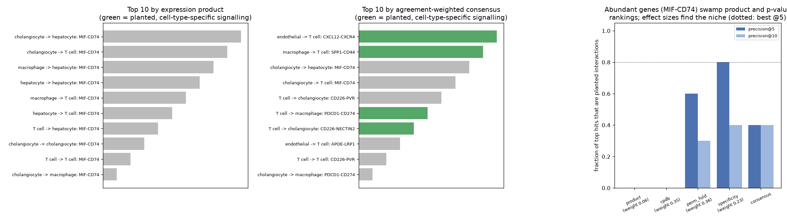

# Ligand-Receptor Scoring

> MIF-CD74 tops nearly every cell-cell communication analysis. That says more about MIF's abundance than about your tissue.

## Demo Output

Produced by `demo.py` from a simulated inflamed bile-duct niche (T cells, cholangiocytes, hepatocytes, macrophages, endothelium). Four cell-type-specific interactions are planted, including T-cell CD226 → cholangiocyte NECTIN2. Left: the top 10 interactions by expression product. Middle: the top 10 by agreement-weighted consensus. Right: precision of each scoring method.

## Why This Exists

Two 2026 papers motivated this repo:
- **Jördens et al.** (*J. Hepatology*) used spatial and single-cell data from a mouse model of bile duct inflammation with CellPhoneDB. They found a CD226-NECTIN2 interaction between T cells and cholangiocytes, then validated it by knock-down and antibody blocking.
- **CellCom2** (Wang et al., *IEEE TCBB*) is a web platform that runs several inference methods and merges them. Its consensus weights each method by how much it agrees with the others.

Under the hood, all of these reduce to a few ways of scoring "ligand in cell A, receptor in cell B". This repo implements four such scores and a consensus, so you can see what each one rewards.

## The Scores

| Score | What it rewards |
|-------|-----------------|
| `product` | mean ligand (sender) x mean receptor (receiver): **abundance** |
| `cpdb` | CellPhoneDB-style permutation p-value of the mean of the two means. With hundreds of cells, small differences give p at the floor, and ties then sort by expression |
| `perm_fold` | the same statistic divided by its shuffled-label average: an **effect size** |
| `specificity` | ligand z-score across senders x receptor z-score across receivers, if both are detected in ≥10% of cells |
| `consensus` | ranks from all four, each weighted by its mean Spearman agreement with the others (after CellCom2's idea) |

## What the Demo Shows

| Method | Precision@5 | Precision@10 | Consensus weight |
|--------|-------------|--------------|------------------|
| product | 0.0 | 0.0 | 0.06 |
| cpdb (p, then mean) | 0.0 | 0.0 | 0.36 |
| perm_fold | 0.6 | 0.3 | 0.36 |
| specificity | **0.8** (the best possible) | **0.4** | 0.23 |
| consensus | 0.4 | 0.4 | |

Two lessons:
1. With hundreds of cells, permutation p-values saturate. What decides the ranking is then the tie-breaker, often plain expression.
2. **Agreement is not accuracy.** The consensus gave its largest weights to the two methods that agreed most, and one of them shared the abundance bias. Here it beat the worst methods but not the best one.

Note also "CD226-PVR" near the top. CD226 has two ligands, so a T-cell-specific receptor drags in its other partner. Only biology (or spatial co-location) can separate them.

## When NOT to Use This

- **As a substitute for CellPhoneDB, CellChat, LIANA or NicheNet.** They use curated multi-subunit complexes and better databases. The 12 pairs here are illustrative.
- **Without spatial context.** Expression says two cells *could* talk, not that they are neighbours. The CD226-NECTIN2 paper confirmed co-localisation at inflamed bile ducts.

## The Uncomfortable Truth

Ligand-receptor inference produces hypotheses ranked by assumptions. The CD226-NECTIN2 result mattered because the authors then knocked down NECTIN2 and blocked CD226 *in vivo*. Without a step like that, the top of the list is a reading list, not a finding.

## Further Reading

- Jördens M. S. et al. "Temporal assessment of spatial and single-cell transcriptomes identifies CD226-NECTIN2 T cell-cholangiocyte interaction in bile duct inflammation." Journal of Hepatology (2026). doi:10.1016/j.jhep.2026.09.021
- Wang J. et al. "CellCom2: An Integrated Web Platform for Flexible Prediction and Visualization Analysis of Cell-cell Communication." IEEE TCBB (2026). doi:10.1109/TCBBIO.2026.3741541
- Efremova M. et al. "CellPhoneDB: inferring cell-cell communication from combined expression of multi-subunit ligand-receptor complexes." Nature Protocols (2020).
- Dimitrov D. et al. "Comparison of methods and resources for cell-cell communication inference from single-cell RNA-Seq data." Nature Communications (2022).
